<div align="center">

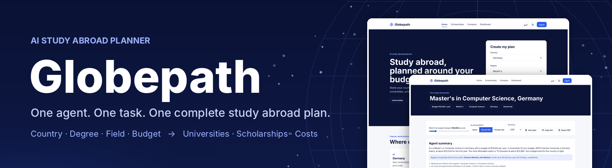

<br>


**[Live demo](#-live-demo)** · **[Screenshots](#-screenshots)** · **[Features](#-features)** · **[How it works](#-how-the-agent-works)** · **[Quick start](#-quick-start)** · **[API](#-api-reference)** · **[Deploy](#-deployment)**

</div>

---

## 📑 Table of contents

1. [About](#-about)
2. [Live demo](#-live-demo)
3. [Screenshots](#-screenshots)
4. [Features](#-features)
5. [How the agent works](#-how-the-agent-works)
6. [Sample output](#-sample-output)
7. [Architecture](#-architecture)
8. [Tech stack](#-tech-stack)
9. [Project structure](#-project-structure)
10. [Quick start](#-quick-start)
11. [Configuration](#-configuration)
12. [API reference](#-api-reference)
13. [Groq and LangSmith](#-groq-and-langsmith)
14. [Deployment](#-deployment)
15. [Testing](#-testing)
16. [Troubleshooting](#-troubleshooting)
17. [Data and accuracy](#-data-and-accuracy)
18. [Roadmap](#-roadmap)
19. [Documentation](#-documentation)
20. [About this project](#-about-this-project)
21. [License](#-license)

---

## 🎯 About

Planning to study abroad means comparing countries, universities, programs, scholarships and costs across many websites. **Globepath** does that work with **one agent that performs one task**:

> Give it your **country**, **degree**, **field** and **budget**. It returns a complete study abroad plan.

| Assignment requirement | Where it lives |
|---|---|
| Take country, degree, budget and field | `backend/agent/analyzer.py` |
| Analyze user data | `analyzer.py` and `university_matcher.budget_level` |
| Top university list under budget | `backend/agent/university_matcher.py` |
| Suggest programs, scholarships, activities | `backend/agent/recommender.py` |
| Estimate fees, accommodation, travel | `backend/agent/cost_estimator.py` |
| Single agent, single task | `backend/agent/study_abroad_agent.py` (`StudyAbroadAgent.run`) |

## 🌐 Live demo

| | Link |
|---|---|
| Vercel (site and API) | `https://globepath-study-abroad-agent-six.vercel.app` |
| Firebase Hosting (site) | `https://globepath-study-abroad-agent.web.app` |

## 📸 Screenshots

| Home | Agent running |
|:---:|:---:|
| 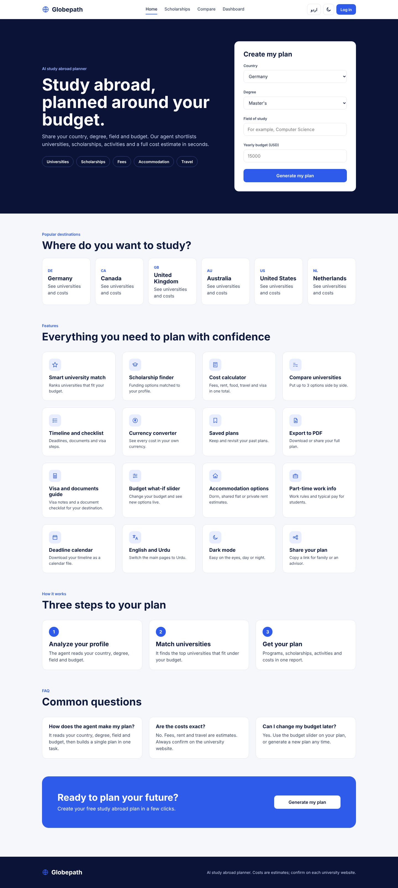 | 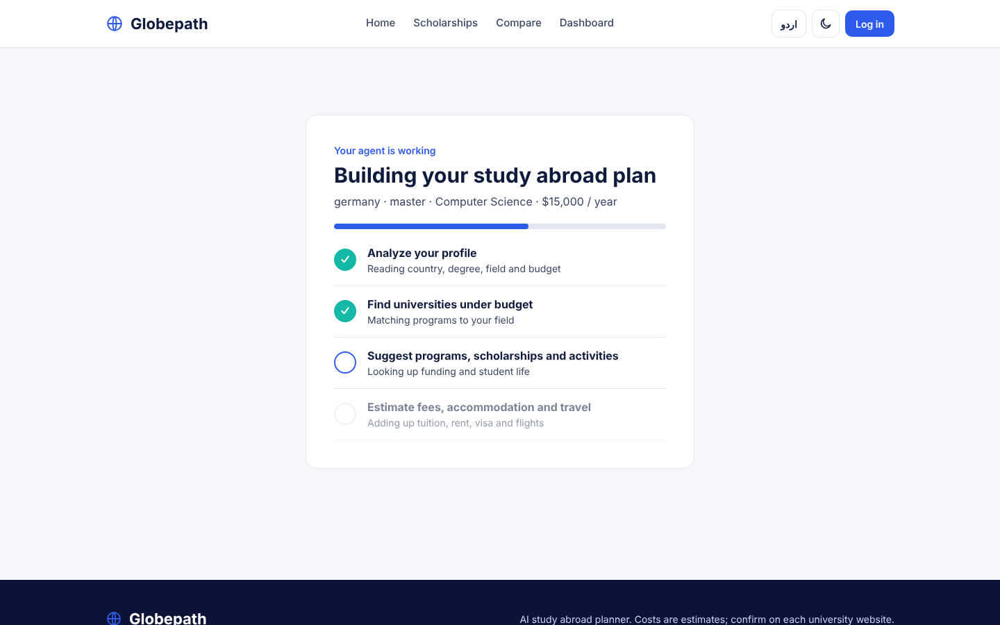 |

| Your plan | Dark mode |
|:---:|:---:|
| 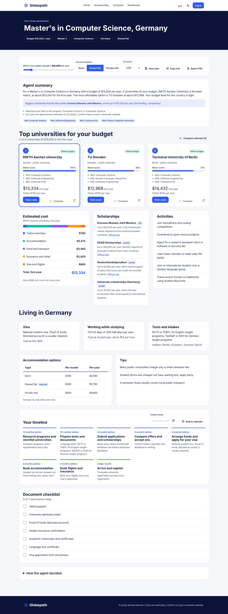 | 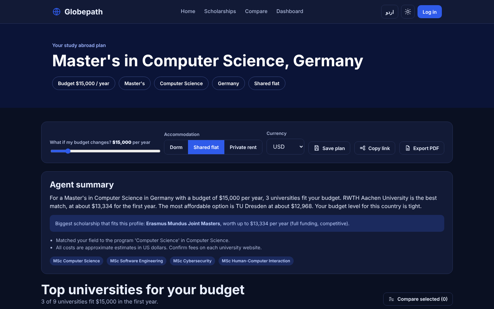 |

| Compare universities | Scholarship finder |
|:---:|:---:|
| 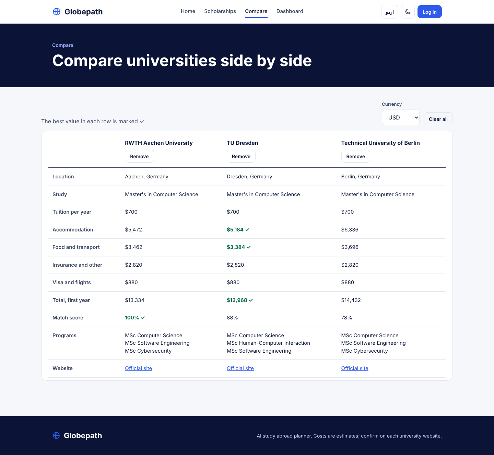 | 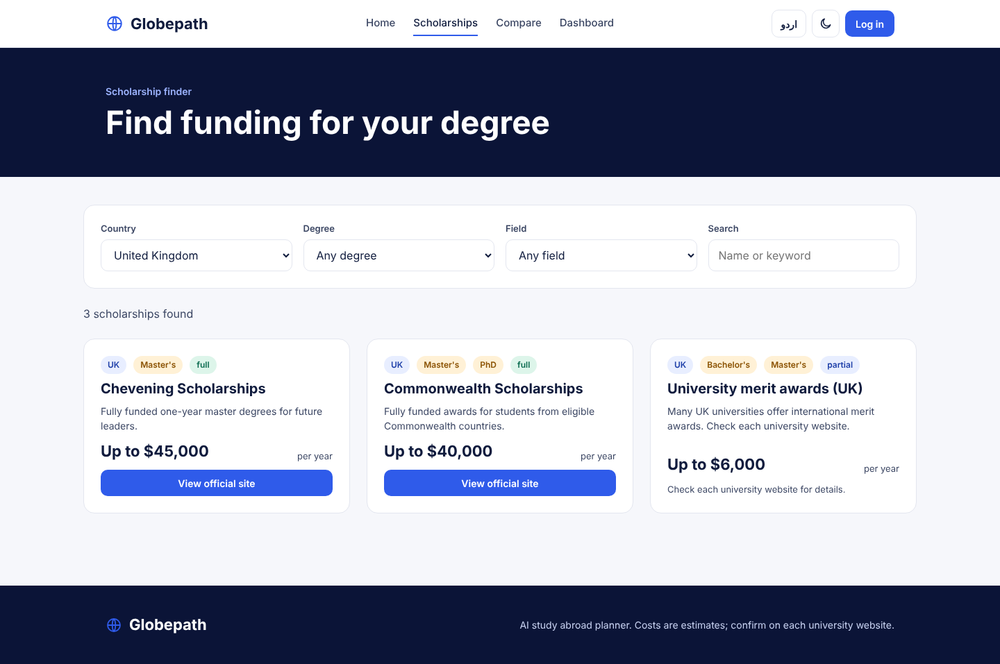 |

| Dashboard | Urdu (right-to-left) |
|:---:|:---:|
| 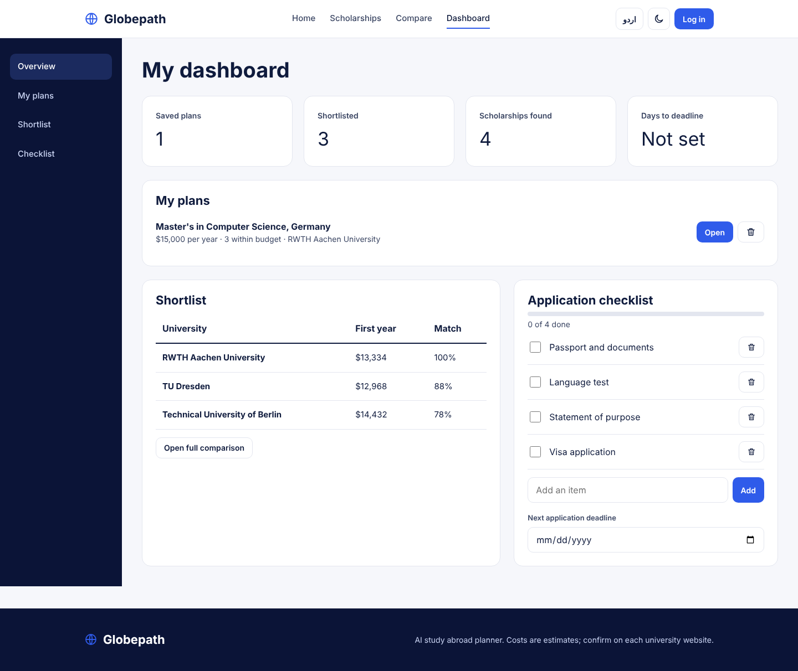 | 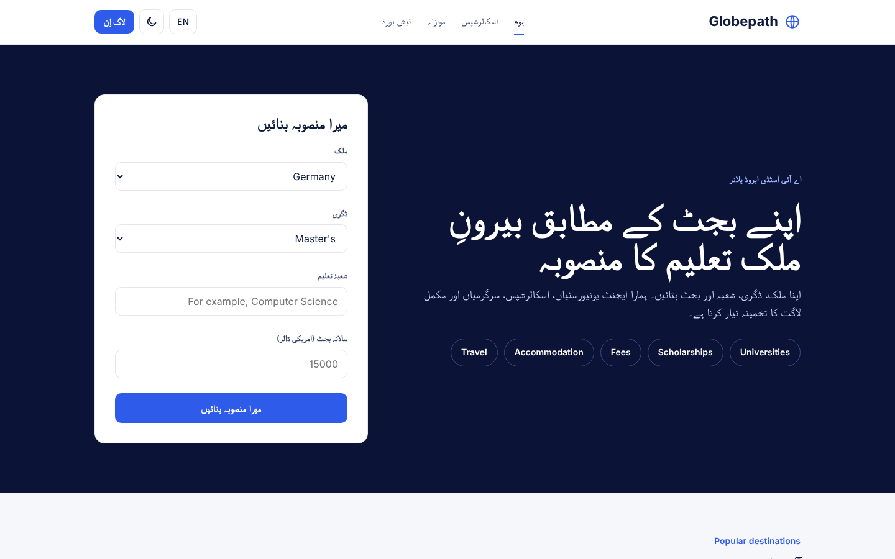 |

| Login | Mobile |
|:---:|:---:|
| 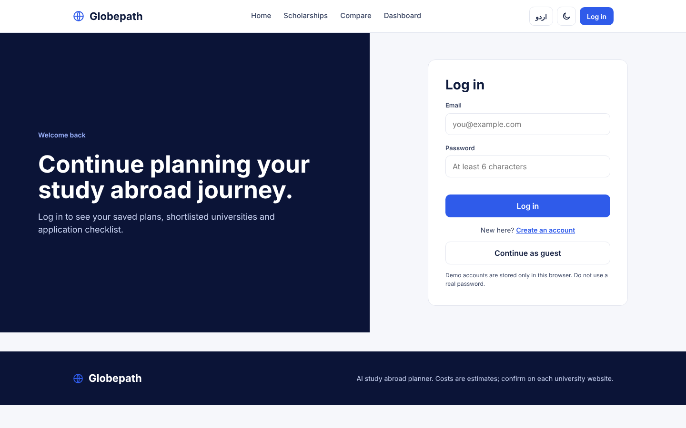 | 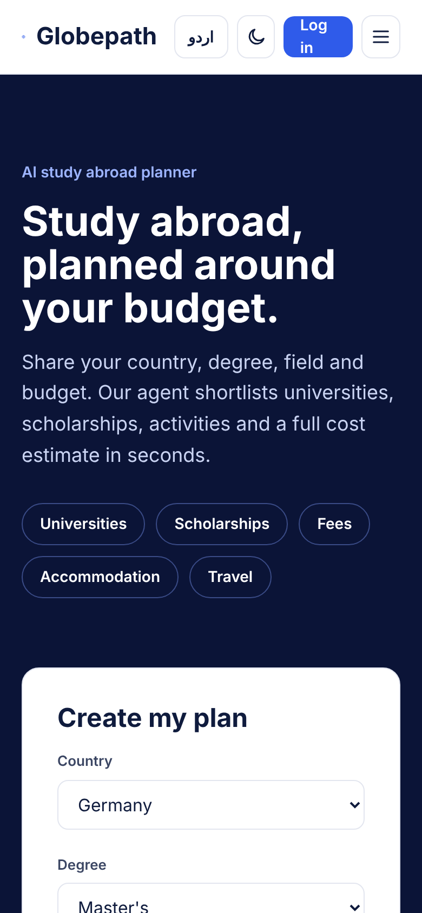 |

> Re-create all screenshots with `python scripts/take_screenshots.py` (see [Testing](#-testing)).

## ✨ Features

| Group | Features |
|---|---|
| 🧠 **Agent** | Single-agent pipeline · input analysis with aliases (`UK`, `MSc`, `ML`) · match score · budget level · agent trace |
| 💰 **Costs** | Tuition, rent, food, transport, insurance, visa and flights · city cost factors · first-year total |
| 🎚️ **Interactive** | Budget what-if slider · accommodation switch (dorm, shared, private) · currency converter (USD, EUR, GBP, CAD, AUD, PKR, INR) |
| 🎓 **Guidance** | Scholarship finder with filters · programs and activities · visa notes · work rules · language tests · intakes |
| 🗓️ **Planning** | 8-step timeline · document checklist · calendar (`.ics`) export |
| ⚖️ **Compare** | Up to 3 universities side by side, best value marked |
| 💾 **Account area** | Saved plans · shortlist · application checklist · deadline counter (demo login) |
| 🔗 **Sharing** | Copy share link · export to PDF |
| 🎨 **Experience** | Dark mode · English and Urdu with RTL · responsive down to phones · animations that respect reduced motion |
| ♿ **Accessibility** | Labelled forms · keyboard navigation · visible focus · skip link |
| 🛠️ **Engineering** | 25 tests · optional Groq summary · optional LangSmith tracing · CORS allow-list · Vercel and Firebase ready |

## 🧭 How the agent works

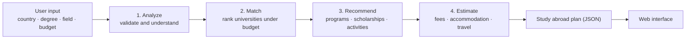

<p align="center">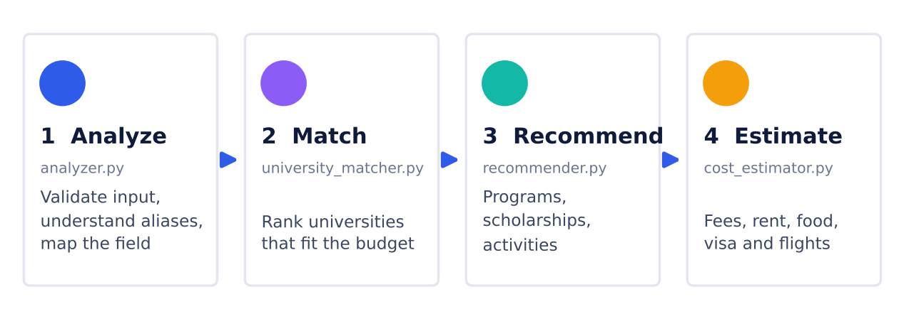</p>

**Step 1. Analyze.** Validates the input, understands aliases and maps your field to one of 8 subject areas. Invalid input returns HTTP 400 with a message for every wrong field.

**Step 2. Match.** For each university in the country that offers your field, the agent estimates the first-year cost and scores it:

```text
match score = 50% × prestige + 50% × budget fit
prestige    : tier 1 = 100, tier 2 = 75, tier 3 = 55
budget fit  : 100 with 10% headroom, 70 at the budget limit, 0 at 25% over
```

<p align="center">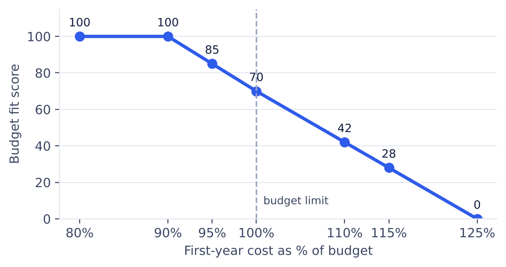</p>

If fewer than three universities fit, the closest over-budget options are shown and marked with the amount over.

**Step 3. Recommend.** Picks programs, eligible scholarships (full or partial funding) and student activities.

**Step 4. Estimate.** Builds the cost breakdown, country guide, timeline and checklist:

```text
annual cost     = tuition + rent×12×city factor + food×12 + transport×12 + misc×12 + insurance
first-year cost = annual cost + visa + return flight
```

## 📊 Sample output

Input: **Germany · Master's · Computer Science · $15,000 per year · shared flat**

| Rank | University | Match | First-year cost | Within budget |
|:---:|---|:---:|---:|:---:|
| 1 | RWTH Aachen University | 100 | $13,334 | ✅ |
| 2 | TU Dresden | 88 | $12,968 | ✅ |
| 3 | Technical University of Berlin | 78 | $14,432 | ✅ |

9 universities offer the field, 3 fit the budget, and the budget level is **tight**.

<p align="center">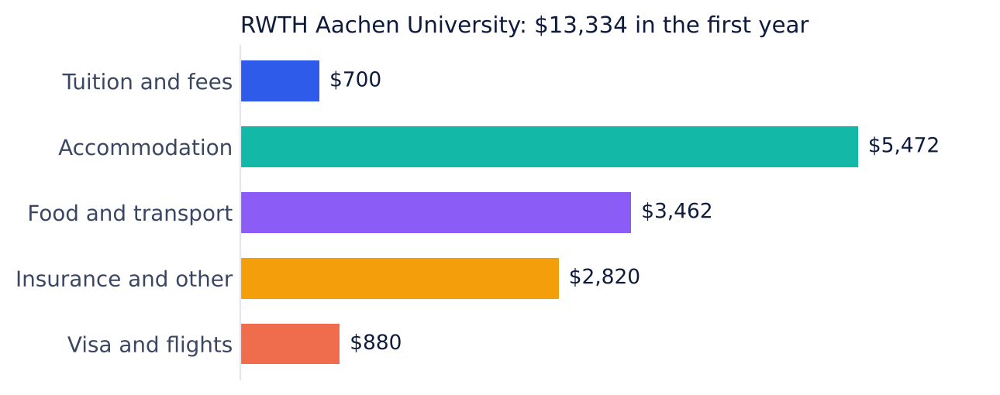</p>

## 🧱 Architecture

<p align="center">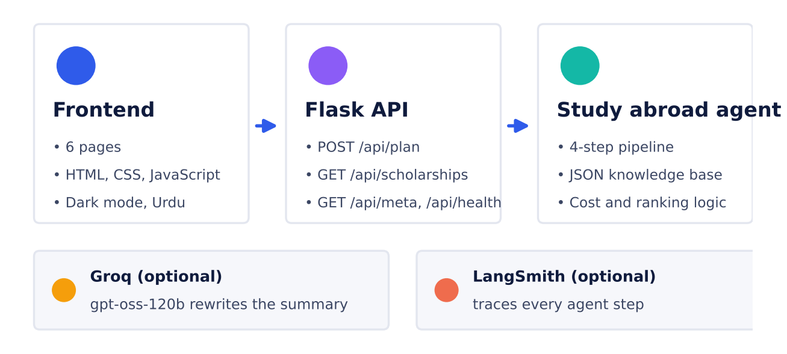</p>

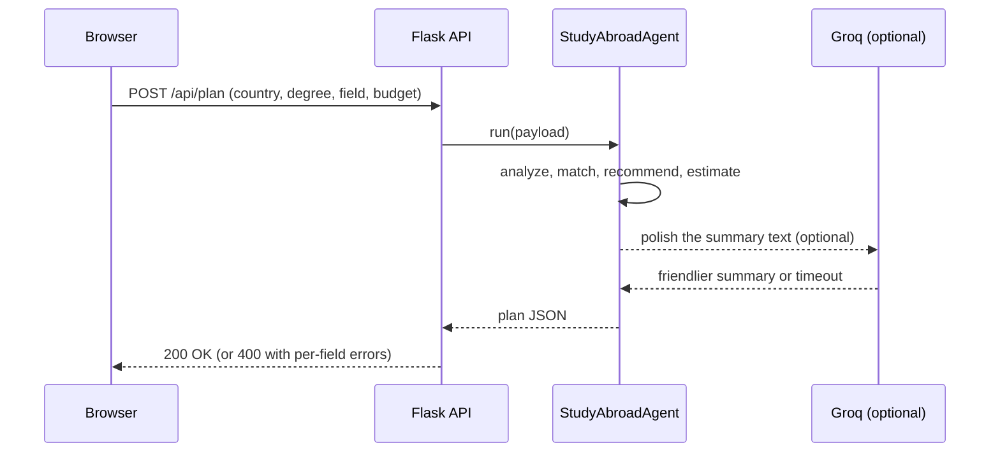

## 🧰 Tech stack

| Area | Tools |
|---|---|
| Backend | Python 3.9+, Flask 3 |
| Frontend | HTML5, CSS3, JavaScript ES modules (no framework) |
| AI (optional) | Groq API, model `openai/gpt-oss-120b` |
| Observability (optional) | LangSmith |
| Testing | `unittest`, Playwright |
| Deployment | Vercel, Firebase Hosting, GitHub |

## 📁 Project structure

```text
globepath-study-abroad-agent/
├── run.py                          # start the app
├── requirements.txt · requirements-dev.txt · .env.example
├── vercel.json · .vercelignore     # Vercel deployment
├── firebase.json · .firebaserc     # Firebase Hosting (frontend)
├── api/
│   └── index.py                    # Vercel entry point
├── backend/
│   ├── app.py                      # Flask app, API, CORS
│   ├── config.py                   # settings and currency rates
│   ├── agent/
│   │   ├── study_abroad_agent.py   # the single agent
│   │   ├── analyzer.py             # step 1
│   │   ├── university_matcher.py   # step 2
│   │   ├── recommender.py          # step 3
│   │   ├── cost_estimator.py       # step 4
│   │   ├── timeline.py             # timeline and checklist
│   │   ├── knowledge_base.py       # loads the JSON data
│   │   ├── llm.py                  # optional Groq / Anthropic summary
│   │   └── tracing.py              # optional LangSmith tracing
│   ├── data/                       # universities, scholarships, countries, fields, activities
│   └── tests/test_agent.py         # 25 tests
├── frontend/
│   ├── index.html · plan.html · scholarships.html
│   ├── compare.html · dashboard.html · login.html
│   └── assets/
│       ├── css/                    # tokens, base, layout, components, pages, print
│       ├── js/                     # one module per page + shared helpers
│       └── img/
├── docs/
│   ├── Globepath_Presentation.pptx # 20-slide presentation
│   ├── Globepath_Project_Report.docx # full project report
│   ├── COMMANDS.md · DEPLOYMENT.md · GITHUB.md
│   ├── images/ · screenshots/
└── scripts/
    ├── take_screenshots.py         # regenerate screenshots
    └── set_api_base.py             # point the frontend at a remote API (Firebase)
```

## 🚀 Quick start

**Requirements:** Python 3.9 or newer.

```bash
# 1. Get the code
git clone https://github.com/scientistayat-engineer/globepath-study-abroad-agent.git
cd globepath-study-abroad-agent

# 2. Create a virtual environment
python -m venv .venv
.venv\Scripts\activate            # Windows
source .venv/bin/activate         # macOS / Linux

# 3. Install and run
pip install -r requirements.txt
python run.py
```

Open **http://127.0.0.1:5000**. The app works fully offline. To add the optional AI summary:

```bash
export GROQ_API_KEY=your_key                # PowerShell: $env:GROQ_API_KEY="your_key"
export GROQ_MODEL=openai/gpt-oss-120b       # this is already the default
python run.py
```

## 🔧 Configuration

Set these as environment variables (see `.env.example`).

| Variable | Default | Purpose |
|---|---|---|
| `HOST` / `PORT` | `127.0.0.1` / `5000` | Server address |
| `FLASK_DEBUG` | `0` | `1` enables auto-reload |
| `GROQ_API_KEY` | empty | Enables AI-polished summaries (checked first) |
| `GROQ_MODEL` | `openai/gpt-oss-120b` | Groq model |
| `ANTHROPIC_API_KEY` / `ANTHROPIC_MODEL` | empty | Optional alternative to Groq |
| `LLM_TIMEOUT` | `8` | Seconds to wait for the AI call |
| `ALLOWED_ORIGINS` | empty | Sites allowed to call the API (for Firebase) |
| `LANGSMITH_TRACING` | `false` | `true` turns tracing on |
| `LANGSMITH_API_KEY` / `LANGSMITH_PROJECT` | empty | LangSmith credentials and project |
| `LANGSMITH_TRACING_BACKGROUND` | SDK default | Set `false` on Vercel |

Currency rates are in `backend/config.py`. Tuition, rent, visa fees and flights are in `backend/data/*.json`, so you can edit them without touching code.

## 🔌 API reference

| Method | Endpoint | Description |
|---|---|---|
| `GET` | `/api/health` | Status, and whether AI summaries and tracing are on |
| `GET` | `/api/meta` | Countries, degrees, fields, currency rates |
| `POST` | `/api/plan` | Run the agent and return a plan |
| `GET` | `/api/scholarships` | Filter by `country`, `degree`, `field`, `q` |

**Request**

```bash
curl -X POST http://127.0.0.1:5000/api/plan \
  -H "Content-Type: application/json" \
  -d '{"country":"Germany","degree":"Master'"'"'s","field":"Computer Science","budget":15000,"accommodation":"shared"}'
```

**Response (shortened)**

```json
{
  "summary": { "headline": "Master's in Computer Science, Germany", "ai_enhanced": false },
  "stats": { "available": 9, "within_budget": 3, "budget_level": "tight", "cheapest_first_year": 12968 },
  "universities": [
    {
      "rank": 1, "name": "RWTH Aachen University", "within_budget": true, "match_score": 100,
      "programs": ["MSc Computer Science", "MSc Software Engineering", "MSc Cybersecurity"],
      "costs": { "tuition": 700, "accommodation": 5472, "food": 3042, "transport": 420,
                 "insurance": 1500, "misc": 1320, "visa": 80, "flights": 800, "first_year": 13334 }
    }
  ],
  "scholarships": [], "activities": {}, "country_guide": {}, "timeline": [], "checklist": [],
  "agent_trace": []
}
```

**Validation error (HTTP 400)**

```json
{ "error": "Please check your details.", "details": { "country": "Choose one of the supported countries: ..." } }
```

## 🤖 Groq and LangSmith

**Groq (optional).** With `GROQ_API_KEY` set, the agent asks `openai/gpt-oss-120b` to rewrite the summary in 3 to 4 friendly sentences using only the facts it is given. The model never picks universities or invents numbers. If the call fails or times out, the plan is returned with the built-in summary.

**LangSmith (optional).** With tracing on, each run is one trace called `study_abroad_plan` with these child spans:

```text
study_abroad_plan
├── analyze_profile
├── match_universities
├── recommend_programs_scholarships_activities
├── estimate_fees_accommodation_travel
└── llm_summary_polish
```

```bash
export LANGSMITH_TRACING=true
export LANGSMITH_API_KEY=your_key
export LANGSMITH_PROJECT=globepath-study-abroad
export LANGSMITH_TRACING_BACKGROUND=false      # recommended on Vercel
python run.py
```

Generate a plan, then open the project in LangSmith. EU accounts also set `LANGSMITH_ENDPOINT=https://eu.api.smith.langchain.com`. When tracing is on, the student's inputs and the generated text are sent to LangSmith.

## 🚢 Deployment

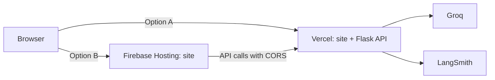

### Step 1: Push to GitHub

```bash
git init
git add .
git status                      # make sure .env is NOT listed
git commit -m "feat: Globepath study abroad agent"
git branch -M main
git remote add origin https://github.com/<your-username>/globepath-study-abroad-agent.git
git push -u origin main
```

### Step 2: Deploy on Vercel (site and API)

1. Open <https://vercel.com/new> and import the repository.
2. Framework preset: **Other**. Leave the build settings alone (`vercel.json` handles them).
3. Add **Environment Variables**: `GROQ_API_KEY`, `GROQ_MODEL=openai/gpt-oss-120b`, and optionally the `LANGSMITH_*` variables.
4. Press **Deploy**, then open `https://<app>.vercel.app/api/health`. `"ai_enhanced_summaries": true` means the Groq key was found.

CLI alternative: `npm i -g vercel`, `vercel login`, `vercel env add GROQ_API_KEY`, `vercel --prod`.

### Step 3 (optional): Add Firebase Hosting

Firebase Hosting serves static files only, so the API stays on Vercel.

```bash
npm i -g firebase-tools
firebase login
firebase use --add                                             # choose your project
python scripts/set_api_base.py https://<app>.vercel.app       # point the frontend at the API
firebase deploy --only hosting
```

Then in Vercel set `ALLOWED_ORIGINS=https://<project>.web.app,https://<project>.firebaseapp.com` and **redeploy**. Without this the browser blocks the requests (CORS). Run `python scripts/set_api_base.py --reset` afterwards to go back to same-origin mode.

Full step-by-step guides: [docs/DEPLOYMENT.md](docs/DEPLOYMENT.md) and [docs/COMMANDS.md](docs/COMMANDS.md).

## 🧪 Testing

```bash
python -m unittest backend.tests.test_agent -v      # 25 tests, under a second
```

| Area | Tests | Checks |
|---|:---:|---|
| Agent | 7 | Plan sections, budget rules, cost totals, low budgets, validation, every country and degree |
| API | 6 | Endpoints, errors, bad bodies, scholarship filters |
| Analyzer | 3 | Aliases and field matching |
| AI summary | 3 | No key, Groq parsing, safe fallback |
| Tracing | 3 | Off by default, no-op fallback, health flag |
| CORS | 2 | Allowed and blocked origins |
| Vercel entry | 1 | Entry point serves API and pages |

**Regenerate the screenshots**

```bash
pip install -r requirements-dev.txt
playwright install chromium
python run.py &                               # keep the app running
python scripts/take_screenshots.py
```

## 🩺 Troubleshooting

| Problem | Fix |
|---|---|
| `ModuleNotFoundError: backend` | Run commands from the project root (the folder with `run.py`). |
| `Address already in use` | Use another port: `PORT=5001 python run.py`. |
| `ai_enhanced_summaries` is `false` | `GROQ_API_KEY` is missing. On Vercel, add it and redeploy. |
| Every page is 404 on Vercel | `vercel.json` and `api/index.py` must be in the repository root. |
| `/api/plan` returns 500 on Vercel | Open Deployments, then Function Logs. |
| Firebase site shows a network error | Set `ALLOWED_ORIGINS` on Vercel and redeploy; check the console for a CORS message. |
| No traces in LangSmith | Set `LANGSMITH_TRACING=true` and the API key; run `pip install -r requirements.txt`; EU accounts set `LANGSMITH_ENDPOINT`. |
| Screenshots script fails | Run `playwright install chromium` and keep `python run.py` running. |

## 📌 Data and accuracy

This is a learning project. Tuition, rent, visa fees, flight prices and exchange rates are **approximate planning estimates** and change often. Always confirm on each university's official website and your government's visa pages. Flight costs assume a return economy ticket from South Asia; edit `backend/data/countries.json` for another origin.

The login is a **client-side demo**: accounts live in your browser only. A real app would need a server, hashed passwords and sessions.

## 🔮 Roadmap

- [x] Single agent with a four-step pipeline
- [x] Budget what-if, compare, scholarships, dashboard
- [x] Dark mode, English and Urdu
- [x] Groq summary and LangSmith tracing
- [x] Vercel and Firebase deployment
- [ ] Live data from official university and scholarship sources
- [ ] Real accounts with a database
- [ ] Chat follow-up questions to the agent
- [ ] More countries, and filters for grades and language scores

## 📚 Documentation

| File | What it is |
|---|---|
| [docs/Globepath_Presentation.pptx](docs/Globepath_Presentation.pptx) | 20-slide project presentation |
| [docs/Globepath_Project_Report.docx](docs/Globepath_Project_Report.docx) | Full project report |
| [docs/DEPLOYMENT.md](docs/DEPLOYMENT.md) | Vercel and Firebase deployment guide |
| [docs/COMMANDS.md](docs/COMMANDS.md) | Every command, step by step |
| [docs/GITHUB.md](docs/GITHUB.md) | Repository description, topics and commands |

## 🎓 About this project

Built as a university assignment: **Single Agent, Single Task** study abroad planner.

| | |
|---|---|
| Student | Anushay Ayat |
| Course | AI and Data Science, Saylani IT Training |
| Instructor | Mehwish |
| Date | 12 November 2026 |

## 📄 License

Released under the [MIT License](LICENSE).

<div align="center">

⭐ If this project helped you, give it a star.

</div>
